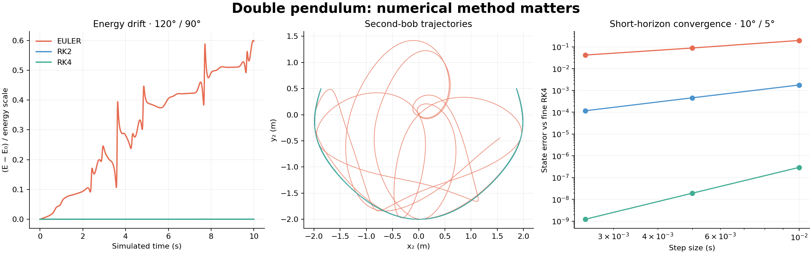

# Planar Double Pendulum

An interactive physics demo and reproducible comparison of three numerical integrators: explicit Euler, Heun RK2 and classical RK4. All three start with the same physical system, making numerical drift visible rather than confusing it with different initial conditions.

The GitHub repository is named `chaotic-3d-pendulum`, but the implemented model is **two-dimensional**. This package keeps that distinction explicit.



## Run in two minutes

Python 3.10+ is required. From this directory:

```bash
python -m venv .venv
source .venv/bin/activate          # Windows: .venv\Scripts\activate
python -m pip install .
pendulum-demo --output results
```

Open `results/comparison.png`. The command also writes all three trajectories as CSV and machine-readable metrics in `summary.json`. It needs no GUI, network service, account or experiment data. Outputs must go to a new or empty directory so existing work is not overwritten.

### Interactive application

```bash
python -m pip install '.[gui]'
pendulum-gui
# Equivalent from the checkout: python main.py
```

- **Start / Pause** advances or freezes the simulation.
- Set each pendulum's masses, lengths, initial angles and method, then **Reset** to apply them.
- Gravity changes also apply on Reset. The time step updates immediately.
- Reset clears both energy and position histories and displays the initial rods.
- The application advances one numerical step per timer frame. Simulated time is **not** wall-clock time.
- Euler can become unstable. Reduce `dt` and Reset if the application reports non-finite values; bounded, finite drift can still be physically wrong.

The desktop UI was executed and visually inspected using Qt's Linux offscreen renderer. Parameter edits, method selection, Start/Pause and Reset are covered by automated Qt tests. Native macOS/Windows display integration has not been tested.

## What the example demonstrates

For equal 1 kg masses, 1 m rods, gravity 9.81 m/s², initial angles 120° / 90°, zero initial velocity, 10 seconds and `dt=0.01 s`:

| Method | Maximum absolute energy drift / 29.43 J |
|---|---:|
| Explicit Euler | 0.599696 |
| Heun RK2 | 0.000245680 |
| Classical RK4 | 0.000000241852 |

The denominator is the fixed gravitational energy scale `(m1+m2) g l1 + m2 g l2`, **not the initial energy**. No dissipation or external drive is included, so energy drift is numerical error.

A separate two-second, small-angle (10° / 5°) test compares endpoint states against fine-step RK4. Halving the step from 0.01 to 0.005 to 0.0025 s gives observed orders near 1, 2 and 4. The fine numerical reference is not an exact solution. The state norm mixes angles and angular velocities with their numerical units; it is a numerical diagnostic, not a physical distance.

These checks do not prove long-term chaotic trajectory accuracy, an optimal integration method, or a new scientific result. Different approximate trajectories alone are not evidence of chaos. See [model and validation](docs/MODEL.md).

## Tests

```bash
python -m unittest discover -s tests -v
```

With the base installation, physics/CLI tests run and Qt tests are explicitly skipped. Install `.[gui]` to run the full suite. On a headless Linux machine:

```bash
QT_QPA_PLATFORM=offscreen python -m unittest discover -s tests -v
```

The suite checks independent mass-matrix equations, energy conservation to first order, small-angle normal modes, rod constraints, short-horizon convergence, invalid inputs, reset/history behavior and GUI controls. It uses the Python standard-library test runner; pytest is not required.

## Project layout

- `double_pendulum/model.py`: physical model, three steppers and bounded history manager.
- `double_pendulum/gui.py`: original Qt/pyqtgraph interface, repaired and separated from the numerical core.
- `double_pendulum/cli.py`: reproducible trajectory/energy/convergence report.
- `tests/`: numerical, input-validation and optional GUI integration tests.
- `examples/`: generated reference CSV, plot and summary, reproducible with the CLI.
- `main`: original single-file source retained for reference; use `main.py` or the installed launchers.
- `docs/`: model equations, walkthrough, provenance and changes.

## Provenance and scope

Based on Zack Donovan's existing [double-pendulum repository](https://github.com/zackdonovan/chaotic-3d-pendulum), commit `991dd6678985a2c8f55613baf7d98afc659ac55a`. The original physics, integrators and interactive layout were retained. The November 2026 revision adds packaging, repairs, tests and diagnostics. See [provenance](docs/PROVENANCE.md) and [changes](docs/CHANGES.md).

The original repository contains no license file; this revision does not introduce a license or change ownership.
